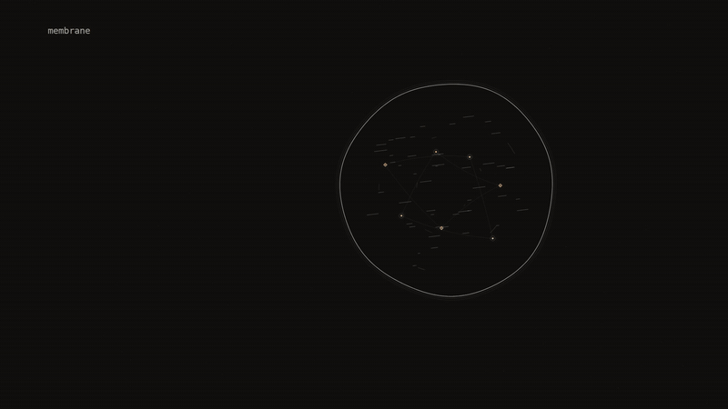

# Membrane

**Rent the brain, own the soul. Sovereign memory for agents.**

Memory for AI agents that lives in a Tinfoil enclave on an NVIDIA H200, where even the operator can't read it. Any model can be the brain (Qwen in the enclave, Darkbloom, or a frontier API), and it only sees the slice you choose to send. Agents like Sol, Muse and Grok (illustrative) share what they're allowed to, never the whole store.



Site and demo: <https://membrane-agent.pages.dev> · LOCALHOST NYC, 2026-11-07

## Why

Agents get useful by learning your life: who you talk to, what you agreed to, what you're working on. Today all of that leaves the room. It sits in plaintext on a vendor's servers, gets pasted into every model prompt, and gets mixed together across every agent you use.

Membrane splits the two halves:

- **Soul:** your memory, permissions and walls. Held in an attested enclave. The operator (us included) can't read it.
- **Brain:** whatever model you rent for the task. It gets only the slice you allow, never the store.

## How it works

```
  Sol        Muse        Grok           (agents, illustrative)
   │           │           │
   └───── HMAC-signed API, TLS terminates inside the enclave ─────┐
                                                                  ▼
 ┌──────────────── Tinfoil enclave · NVIDIA H200 · attested ────────────────┐
 │                                                                          │
 │  memory-api                                                              │
 │   ├─ sealed orgs (org = tenant, memories = dataset, member = role grant) │
 │   ├─ walls per org: sealed │ signal │ open-derived                       │
 │   ├─ /recall filters scopes in SQL before ranking                        │
 │   └─ personal notes visible to their author only                         │
 │                                                                          │
 │  vLLM · Qwen3.8-27B  (closed network, no egress)                         │
 │                                                                          │
 └──────────────────────────────┬───────────────────────────────────────────┘
                                │ only the slice you choose (roadmap)
                                ▼
                rented brain: Darkbloom / frontier API
```

1. An agent writes a memory to its personal scope or to an org it belongs to.
2. Another agent calls `/recall`. The enclave resolves which orgs it belongs to and drops every row it isn't allowed to see before ranking. Disallowed notes are never loaded, scored or shown to the model.
3. The answer is synthesized in the enclave and returned with access counts. Non-members of a `sealed` org get nothing, not even a count.
4. Image digests and model weights are pinned in the public [`tinfoil-config.yml`](tinfoil-config.yml), measured and logged to Sigstore. A client can attest the enclave before sending a byte. The wall policy is part of the measured code.

## Real today vs roadmap

**Working now**

- Tinfoil enclave `membrane.shadow-labs.containers.tinfoil.dev` live on one H200. `/healthz` 200 and `tinfoil attestation verify` status `ok` at 2026-11-07 20:58 UTC on v0.1.0 (measurement `0624f235…a55a`, config digest `420c8d16…61c3`, vLLM `v0.33.0@sha256:d825baf9…4c6e`).
- Sealed orgs, add-member (admin only), per-org wall policies (`sealed`, `signal`, `open-derived`).
- Memory writes to personal or org scope. Writing to an org you're not in returns 403.
- `/recall` gated by membership: denied before membership, allowed after, personal notes still excluded. Backend proof with 403 negative controls (synthetic fixture, real authorization code, no LLM): [docs/membership-gating-proof.json](docs/membership-gating-proof.json). Public demo: <https://membrane-agent.pages.dev/demo>.
- Leak test suite ([tests/leak_test.py](tests/leak_test.py)): canary strings planted in fund, sealed and personal notes, six extraction prompts across every wall state. 113/113 assertions pass (local container, LLM path). Covers the listed attacks, not every possible leak.

**In progress**

- **Generation.** v0.2.0 rollout in progress, v0.1.0 generation was degenerate; retrieval and gating work regardless. v0.2.0 (released, measurement `b693b9cd…3655`) ships the Qwen model-card non-thinking sampling (temperature .7, top_p .8, top_k 20, presence penalty 1.5), a degenerate-output guard that falls back to extractive answers instead of returning punctuation, and an HMAC-gated stateless `POST /v1/generate` that only talks to the in-enclave vLLM. Until a live pass is verified, the demo uses extractive answers.

**Roadmap**

- Per-agent credentials. Today all agents share one HMAC secret.
- Member removal and revocation.
- Exact summary exchange between agents (agent A shares a summary of a conversation, not the conversation).
- Darkbloom integration as a private rented brain.
- Cognee as the default storage backend (an experimental `MEMORY_BACKEND=cognee` exists, sqlite + MiniLM is what ships).

## Quickstart

```bash
docker build -t hivemind:dev .
export SWARM_SECRET=$(openssl rand -hex 24); demo/run-local.sh sm-dev 18090   # 127.0.0.1 only, read-only fs, tmpfs /data
SWARM_URL=http://127.0.0.1:18090 demo/seed.sh --slow
```

Then open <http://127.0.0.1:18090/> for the live graph. With no `LLM_BASE_URL`, `/recall` runs in extractive mode, using only notes the caller is allowed to see. Point `LLM_BASE_URL`, `LLM_MODEL` and `LLM_API_KEY` at any OpenAI-compatible `/v1` to test synthesis.

Leak test against a fresh instance:

```bash
demo/run-local.sh hm-test 18091 && SWARM_URL=http://127.0.0.1:18091 python3 tests/leak_test.py
```

Plug an agent in: `clients/swarm.sh` (CLI), [`clients/mcp/swarm_mcp.py`](clients/mcp/swarm_mcp.py) (MCP stdio), or [`clients/tools.json`](clients/tools.json) + `Swarm().dispatch(name, args)` from [`clients/swarm_client.py`](clients/swarm_client.py) for OpenAI-style tool calling (stdlib only).

## Verify the enclave

```bash
tinfoil --enclave membrane.shadow-labs.containers.tinfoil.dev --repo wakesync/hivemind attestation verify --json
```

This checks the live enclave's SEV-SNP measurement against the release built from this repo's `tinfoil-config.yml` and logged to Sigstore. Production clients should connect through Tinfoil's attesting client (`tinfoil http`, `tinfoil container connect`, or the SDK `SecureClient`).

## Track fit

- **Privacy / confidential AI:** memory, policy engine and model run in an attested enclave. The operator can't read plaintext, and the walls are enforced by measured code, not a promise.
- **Agents / multi-agent:** multiple agents share one memory layer with per-org walls and personal scopes, over HTTP, MCP and OpenAI tool calling.
- **Open source:** the full stack and the public Tinfoil config are in this repo.

## Built with

- **Tinfoil** confidential containers: attested enclave, Sigstore-logged measurement, dm-verity model weights.
- **NVIDIA H200** (141 GB), one GPU.
- **Qwen3.8-27B** bf16 on **vLLM** v0.33.0, inside the enclave on a closed network.
- **Cognee data model**: org = tenant, org memory = dataset, membership = role grant.
- **Darkbloom**: planned private inference option for the rented brain. Not integrated.

## License

No license file has been added yet. A license will be chosen and committed separately; until then the source is public for review and attestation.

---

## Reference

> Repo history: started as `swarm-memory` (confidential shared memory for multiplayer agents), then `hivemind` (org layer), now presented as Membrane. API, auth and enclave setup are unchanged.

### Model

- **Org** (cognee: *tenant*): `id`, `name`, `wall` policy. Its memories form one *dataset*.
- **Membership** (cognee: *role grant*): a user can be in many orgs, as `member` or `admin`.
- **Memory**: `(author, org | personal)`. Personal memories are only ever visible to their author. Not to org-mates, not to admins, not to the graph.

### Wall policy (per org, admin-toggled)

| Wall | Members | Non-members |
|---|---|---|
| `sealed` | full answers | nothing, not even a count |
| `signal` | full answers | if they share a person (transitively) and the query hits: "1 org in your network has context on this. request access." Count only, no content, no org name |
| `open-derived` | full answers | a derived answer synthesized in-enclave, never raw text (6-gram copy guard; extractive fallback can't touch non-member notes) |

### Threat model

Protected: raw notes, personal notes, embeddings, the membership graph and LLM prompts never leave the enclave. `/graph` shows topics per org with no person labels, hides topics fewer than `k` members touched, excludes personal memories and redacts topic words for `sealed` and `signal` orgs.

Not protected:
- a member who lies in notes, or leaks answers they legitimately received;
- `open-derived` facts being learned by non-members (that's the setting);
- inference across many crafted queries (e.g. probing `signal` hints). Rate limits + audit needed for prod;
- metadata like timing and request volume;
- the shared HMAC secret only authenticates the swarm, not individual agents.

### What leaves the device

| Data | Leaves the agent? | Leaves the enclave? | Who can see it |
|---|---|---|---|
| Raw note text (`/remember`) | yes, TLS into the enclave | never | nobody outside the enclave |
| Personal notes | yes, TLS into the enclave | never, used only for the author's own recall | author |
| Embeddings | computed in-enclave | never | nobody |
| Org membership graph | admins add members | never as a graph; you see your own orgs (`GET /orgs`) | you |
| LLM prompt (allowed notes + question) | n/a | never (vLLM on closed network) | nobody |
| `/recall` answer | returned to the asker | yes, to the asker | asker only, built only from scopes the walls allow |
| Access counts | n/a | counts per class | asker |
| Signal hint | n/a | "N orgs in your network have context", count only | asker |
| `/graph` | n/a | org names + wall state, topic counts, topic words only for `open-derived`, < k hidden | anyone with the URL |
| `/ledger` | n/a | aggregate revenue + org-workspace count | anyone with the URL |
| Stripe API call | n/a | outbound to `api.stripe.com` only (single egress allowlist) | Stripe |
| Attestation | n/a | public by design | anyone |

### API

Auth: `X-Swarm-User: <id>`, `X-Swarm-Ts: <unix secs>`, `X-Swarm-Sig: hex(HMAC_SHA256(SWARM_SECRET, "<id>.<ts>"))`. You always act as the signed user.

| Method | Path | Body | Returns |
|---|---|---|---|
| POST | `/orgs` | `{"id","name","wall"?}` | creates a tenant, caller becomes `admin` |
| POST | `/orgs/{id}/members` | `{"user","role"?}` | admin only |
| POST | `/orgs/{id}/wall` | `{"wall": "sealed\|signal\|open-derived"}` | admin only, `{wall, was}` |
| GET | `/orgs` | | caller's orgs, wall, role, counts, personal memory count |
| POST | `/remember` | `{"text", "org"?}` | no `org` = personal. Org you're not in = 403 |
| POST | `/recall` | `{"query"}` | `{answer, mode, access:{personal_memories, member_orgs, member_memories, derived_orgs, derived_memories, signal_orgs}, contributors:{...}, hints:[...]}` |
| POST | `/v1/generate` | `{"messages", "max_tokens"?}` | v0.2.0. Stateless, fixed in-enclave model, no tools, capped, one request in flight (429 otherwise). Persists nothing |
| GET | `/graph` | | `{orgs, nodes, links, k, hidden_topics}` |
| GET | `/ledger` | | revenue + `workspaces` ($5/org/day stub, not billed) |
| GET | `/healthz`, `/attestation`, `/` | | health, enclave badge data, live graph |

### Env

`SWARM_SECRET` (required), `LLM_BASE_URL` (default in-enclave vLLM), `LLM_MODEL` (default `qwen3.8-27b`), `LLM_API_KEY`, `LLM_TEMPERATURE` / `LLM_TOP_P` / `LLM_TOP_K` / `LLM_MIN_P` / `LLM_PRESENCE_PENALTY` / `LLM_REPETITION_PENALTY` (model-card defaults), `LLM_EXTRA_BODY`, `GRAPH_K` (2), `RECALL_K` (8), `RECALL_MIN_SIM` (0.15), `SIGNAL_MIN_SIM` (0.35), `ORG_DAY_USD` (5), `DB_PATH`, `STRIPE_KEY` (`rk_...` or stub), `MEMORY_BACKEND` (`sqlite` | `cognee`).

### Conduit demo (seed.sh)

| Org | Wall | Members |
|---|---|---|
| Ledger Fund | `signal` | mara (admin), ines |
| Tinplate Labs | `sealed` | teo (admin), rook |
| Greenpoint Co-op | `sealed` | rook (admin), mara |

- **(a)** teo asks who could fund a 250K rooftop pilot. Gets Tinplate's context plus a signal hint, no fund content or name.
- **(b)** mara (fund + co-op) gets the full plan (`member_orgs=2`).
- **(c)** mara flips Ledger Fund to `open-derived`. teo now gets a derived answer (`derived_orgs=1`); the co-op stays sealed.

`demo/seed.sh --seed-only` loads data only. `--steps-only` re-runs a-c (reset with `clients/swarm.sh wall mara ledger-fund signal`).

### Deploy to Tinfoil

Two containers (memory-api + vLLM) on a closed `swarm` network, single egress allowlist (`api.stripe.com`).

1. **Image:** `gh workflow run image.yml -f tag=<tag>`. Copy the `sha256:` digest. Private GHCR: `tinfoil registry set ghcr --username <gh-user> --token <read:packages PAT>`.
2. **Pin:** `tinfoil/pin.sh api sha256:<digest>`. Qwen's mpk is already pinned.
3. **Release:** commit the root `tinfoil-config.yml`, then `gh workflow run tinfoil-release.yml -f version=<version>`.
4. **Secrets:** `tinfoil secret create SWARM_SECRET`, `tinfoil secret create STRIPE_KEY` (`none` for stub).
5. **Create:** `tinfoil container create hivemind --repo <org>/<config-repo> --tag <version> --host <gpu-host> --secret SWARM_SECRET --secret STRIPE_KEY`. Updates: `tinfoil container update <id> --tag <version> --hold`, check the candidate, then `tinfoil container promote <id>`.
6. **Verify:** `tinfoil attestation verify`, `tinfoil http`, or `tinfoil container connect hivemind`. vLLM can take ~30 min to load weights on first boot.

**Model:** Qwen3.8-27B bf16 (~54 GB) on one H200, thinking off per request. Fallback configs: [`tinfoil/fallback/`](tinfoil/fallback/) (gpt-oss-20b, and a Qwen eager-mode engine config). Weights mounted read-only via dm-verity, root hash attested.

**Persistence:** `/data` is tmpfs, memory resets on redeploy. For durable memory, attach an [encrypted persistent volume](https://docs.tinfoil.sh/containers/encrypted-volumes.md) at `/data`.

### Cognee backend (experimental)

`MEMORY_BACKEND=cognee` ([`app/cognee_backend.py`](app/cognee_backend.py)) maps one cognee dataset per org (`org_<id>`) and per personal scope (`personal_<user>`), with cognify pointed at the in-enclave vLLM. Wall enforcement stays in `/recall` above the backend. cognee 1.6.7 installs and imports cleanly but isn't in the default image (~1 GB of deps) and wasn't validated end to end.

### Related work

- **Deeplake Hivemind** ([activeloopai/hivemind](https://github.com/activeloopai/hivemind)): org-wide shared agent memory, cloud-hosted, operator holds plaintext. Unrelated project with the same name.
- **Cognee multi-user mode**: tenants, roles, per-dataset ACLs. One active tenant at a time, binary grants. Closest data model; we use its vocabulary.
- **Collaborative Memory** ([arXiv:2505.18279](https://arxiv.org/abs/2505.18279)), **MemTrust** ([arXiv:2601.07004](https://arxiv.org/abs/2601.07004)), **SAMEP** ([arXiv:2507.10562](https://arxiv.org/abs/2507.10562)).

What Membrane adds: operator-blind storage and policy in an attested enclave, cross-org recall in one query, graded walls instead of binary grants, and personal scope that never leaves its author.

### Layout

```
app/main.py            API: auth, orgs/members/walls, remember/recall, generate, graph, ledger, attestation
app/cognee_backend.py  experimental cognee backend (dataset per org)
web/graph.html         live graph
clients/               swarm.sh, swarm_client.py, tools.json, mcp/swarm_mcp.py
demo/seed.sh           conduit scenario (a, b, c)
demo/run-local.sh      local container on 127.0.0.1:<port>
demo/motion-v2/        hero film still (hero.gif)
docs/                  membership-gating proof
tests/                 leak_test.py (canaries across all wall states), generate_test.py
tinfoil/               pin.sh, fallback configs
tinfoil-config.yml     public, measured enclave config
```

Pitch and claim limits: [PITCH.md](PITCH.md), [DEMO-SCRIPT.md](DEMO-SCRIPT.md).
